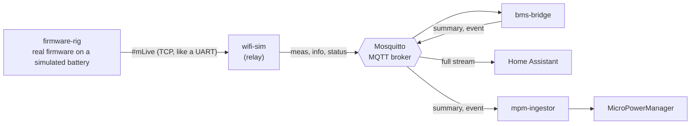

<p align="center">
  <a href="https://github.com/EnAccess/oseas26-libre-solar-bms-monitoring-gateway">
    
  </a>
</p>
<p align="center">
    October 26-27 | Open Source in Energy Access Symposium Hackathon | Kigali, Rwanda
</p>

---

# Open Remote Monitoring Gateway for Libre Solar BMS

An open, deployable remote monitoring gateway that reads live data from the Libre
Solar BMS, publishes it to a standard MQTT layer, and makes it visible in the
tools operators and the community already use.

## Team Haske solution

A working gateway built on the schema in [`docs/mqtt-schema.md`](docs/mqtt-schema.md). It runs the real BMS firmware on a simulated battery (the **firmware rig**); real-hardware transport is the next step.



| Service | What it does | Host port |
|---------|--------------|-----------|
| `mosquitto` | MQTT broker (the single hub) | 1883 |
| `firmware-rig` | The real Libre Solar firmware (Zephyr `native_sim`) fed by a battery model; serves its `#mLive` line on TCP 3333; scenarios `normal`, `cell_drift`, `overheat`, `cloudy` ([readme](services/firmware-rig/readme.md)) | 8010 (3333) |
| `wifi-sim` | The relay: reads the serial `#mLive` line, publishes `meas`, `info` and status over MQTT. Forwards only; reference for the real ESP32/Cicada relay | 8013 |
| `bms-simulator` | Pure-Python fallback without the firmware (`--profile sim`) | 8014 |
| `bms-bridge` | Derives health score, state of health and fault events; publishes `summary` and `event` topics; Home Assistant discovery | 8011 |
| `homeassistant` | Receives the full stream as auto-discovered entities | 8123 |
| `mpm-ingestor` | Sends low-frequency summaries and fault events to MPM (persistent MQTT session, on-disk outbox with retry) | 8012 |

MicroPowerManager only receives the low-frequency summary and fault events, shown as a **Battery Health** page (list plus detail page with a fault log and recommended actions). Home Assistant gets the full stream.

Each service has its own readme next to its code: [`firmware-rig`](services/firmware-rig/readme.md), [`bms-bridge`](services/bms-bridge/readme.md), [`mpm-ingestor`](services/mpm-ingestor/readme.md).

### Quick start (firmware rig, Home Assistant)

Requires Docker. The first build compiles the real firmware (several GB download, a few minutes) and is Linux/amd64 only, so on Apple Silicon it runs under emulation.

```bash
cp .env.example .env
docker compose up --build -d
```

- Home Assistant: http://localhost:8123 (the BMS device appears automatically).
- Check the rig: `curl localhost:8010/health` and `curl localhost:8010/state` (the model's hidden truth).
- Trigger a fault: `curl -X POST http://localhost:8010/scenario/overheat`, then `curl -X POST http://localhost:8010/scenario/normal` to reset. Scenarios: `normal`, `cell_drift`, `overheat`, `cloudy`. They change the simulated battery only; the firmware reacts as it would to real readings.
- Pure-Python fallback without the firmware: `RELAY_SOURCE=http://bms-simulator:8000/live docker compose --profile sim up --build -d`.

**Time speed.** `SPEED` runs the firmware's battery faster than real time and also sets the bridge `TIME_SCALE`, so cycle counting stays consistent. `docker-compose.yml` defaults to `60` so faults and summaries show up within minutes, but at `SPEED > 1` the state of charge starts at 0 until the firmware's first full-charge reset. `.env.example` sets `SPEED=60` (real time, SoC initialised from the cells at boot). A real BMS needs `SPEED=1`.

**Real hardware.** Point the relay at a BMS C1's UART instead of the rig: `RELAY_SOURCE=serial:COM5` (or `/dev/ttyUSB0`). `tcp://`, `file:` and `http://.../live` sources are also supported.

| Port | Service |
|------|---------|
| 1883 | Mosquitto |
| 3333 | Firmware `#mLive` line (TCP, UART stand-in) |
| 8010 / 8011 / 8012 / 8013 / 8014 | firmware-rig / bms-bridge / mpm-ingestor / wifi-sim / bms-simulator APIs |
| 8123 | Home Assistant |

`docker-compose.dev.yml` adds a `dev` container (only Docker needed on the host) on the same network; see [`docs/docker-only.md`](docs/docker-only.md).

### Add MicroPowerManager

MPM runs separately and gets our plugin through an overlay. Follow [`integrations/micropowermanager/README.md`](integrations/micropowermanager/README.md) (includes the Windows workarounds), then set `MPM_API_KEY` in `.env`. Never commit the real key.

### Status

- Done: schema, firmware rig (real firmware on a simulated battery, closed loop with the FET state), serial/TCP relay, bridge, Home Assistant integration, MPM ingestion and Battery Health page. Verified: an overheat scenario raised `CHG_OVERTEMP` and `DIS_OVERTEMP` in the real firmware and the events reached the MPM ingestor.
- Next: test against a real BMS C1 over serial, SMS alerts through MPM, Prospect adapter, persisting the cycle count across restarts, the A2 Cicada relay (`services/cicada-relay-sim` is a placeholder).
- Known limits: state of health is a simple cycle-model estimate; the rig models chip protections but not chip cell balancing, so it validates message formats and firmware behaviour, not protection hardware; the broker is anonymous (demo only).

---

## Abstract and goal

The Libre Solar BMS is a capable open-source battery management system, but once
deployed in the field it is effectively a black box. Operators have no
straightforward, open way to see what a pack is doing — state of charge, cell
balance, temperature, fault history — or to adjust its configuration without
physically visiting the site. This pushes operators toward proprietary monitoring
hardware and recurring cloud subscriptions, or leaves them flying blind. Across
Sub-Saharan Africa, where site visits are costly and connectivity varies widely,
early detection of a failing cell, an over-temperature event, or an undersized
system can be the difference between a quick fix and a dead battery bank.

The goal is an open, deployable remote monitoring gateway that reads live data
from the Libre Solar BMS, publishes it to a standard MQTT layer, and makes it
visible in the tools operators and the community already use.

A crucial design point drives the whole architecture: the three consumer
platforms are different in kind, and the data must be shaped for each.

- **MicroPowerManager (MPM)** is a customer-and-asset management platform
  (Laravel + MySQL) — essentially a CRM/ERP for decentralised utilities. It is
  *not* a
  timeseries database and must not be treated as one. MPM should receive
  low-frequency, decision-relevant battery state as asset metadata and events,
  shown in the battery's asset view — the numbers an operator acts on, not a
  high-resolution trace.
- **Home Assistant and Prospect (A2EI)** are open-source, self-hostable
  monitoring platforms built to handle timeseries telemetry. They are the right
  home for live/historical curves and dashboards. Both are read-only consumers;
  neither controls the battery.

Because all three read from the same MQTT feed, the real deliverable is a clean,
documented MQTT topic + JSON schema. Get that right and each platform is just a
subscriber; MPM takes a downsampled/event slice, while Home Assistant and
Prospect take the full stream.

## Expected outcomes

A new repository being created and populated to provide:

- **BMS simulator (first step):** a script that publishes representative BMS JSON
  to MQTT against the agreed schema. This unblocks all software work and is the
  reference for the data contract.
- **Documented MQTT schema:** topic structure and JSON payloads, including Home
  Assistant auto-discovery, as the project's source of truth.
- **MPM integration:** an ingestion path that writes the low-frequency metrics
  into MPM, and a battery-health view in the asset UI (SoC, SoH/cycles,
  imbalance, max temperature, fault log, last-seen).
- **Home Assistant integration:** entities appearing automatically via MQTT
  auto-discovery.
- **One real transport path proven end-to-end:** either A1 (BMS publishes MQTT
  over WiFi) or A2 (BMS → UART → Cicada → cellular → broker), demonstrated
  against the shared real BMS — with the simulator as fallback.
- **Documentation:** setup and reproduction steps so the result is a
  field-deployable monitoring kit (target users: SLS Energy and other Libre Solar
  deployments).

## Required knowledge

### Stack

- **BMS simulator (first step):** a small script that publishes representative BMS
  data (JSON) to MQTT, standing in for real hardware. This is built and used
  before any board is touched.
- **BMS firmware:** Zephyr RTOS on the Libre Solar BMS (ESP32-C3 target) — the
  source of the battery data and the target of any (stretch) configuration
  commands.
- **Transport layer:** either MQTT-over-WiFi published directly from the BMS, or a
  UART stream relayed by an EnAccess Cicada 4G module (Mbed OS / STM32, SIM7600
  modem) over cellular.
- **Message broker:** an MQTT broker (Mosquitto) as the single hub; a documented
  topic + JSON schema is the project's source of truth.
- **Backend / integration:** a service that consumes MQTT and writes battery state
  into MPM, plus adapters that let Home Assistant and Prospect consume the same
  feed.
- **Frontend:** a battery-health view inside MPM's existing asset UI. (Home
  Assistant and Prospect generate their own dashboards from the feed — no custom
  frontend needed there.)

### Programming languages

- **Python or JavaScript / TypeScript** — the simulator, the backend ingestion
  service, and the platform adapters. This is the bulk of the core work and needs
  no embedded skills.
- **C / Zephyr** — BMS firmware: WiFi + MQTT client (path A1) or a framed UART
  export (path A2), plus the optional config handler.
- **PHP / Laravel 11 + Vue.js 2** — MPM's own stack, for the battery-health asset
  view and the ingestion endpoint on the MPM side (MySQL 8, PHP 8, Node 18).
- **C / Mbed OS** — Cicada relay firmware (path A2 only). Not code-compatible with
  the BMS Zephyr stack; the two communicate only over the defined UART contract.

### Helpful experiences

- MQTT: brokers, topic design, and Home Assistant's MQTT auto-discovery
  convention.
- Backend/API integration in Python or TypeScript.
- Docker (running Mosquitto, Home Assistant, MPM, and Prospect locally).
- Embedded C / an RTOS — for the firmware paths only (Zephyr especially; Mbed OS
  for the relay).
- Serial / UART protocol design (framing, checksums) — path A2 only.
- Basic battery/BMS literacy — enough to know what the telemetry means (mentoring
  available from the case giver).

## Person of contact supporting this challenge

- Joscha Winzer

## Getting started

- Join the OSEAS Discord server: <https://community.oseas.org/>
- Introduce yourself in the `#introductions` channel and join the relevant
  channels for this challenge.
- Read the documentation:
  - <https://enaccess.org/materials/battery-management-system/>
  - <https://github.com/LibreSolar/bms-firmware>
  - <https://github.com/LibreSolar/bms-c1>
  - <https://micropowermanager.io/get-started.html>
  - <https://github.com/EnAccess/micropowermanager/>
  - <https://github.com/home-assistant>
  - <https://www.home-assistant.io/installation/>
  - <https://github.com/zephyrproject-rtos/zephyr>
  - <https://github.com/eclipse-mosquitto/mosquitto>
  - <https://github.com/prospect-server>
