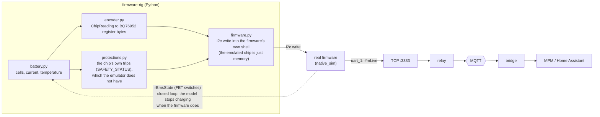

# Firmware rig

The **real Libre Solar BMS firmware** (Zephyr `native_sim`) running on a **simulated battery**. To the software around it, it looks like a BMS C1 on a serial port: the firmware's `#mLive` line is served on TCP port 3333, exactly where the relay would read a real UART (`SOURCE=tcp://firmware-rig:3333` instead of `serial:COM5`).



## Files

| File | Job |
|------|-----|
| `encoder.py` | `ChipReading` to register writes (mV, 10 mA, 0.1 K, signed, clamped), shell command formatting (15 data bytes per command, Zephyr's 20-word limit) |
| `protections.py` | Over/under voltage, temperature and current trips with hysteresis, as `SAFETY_STATUS_A/B` bits |
| `firmware.py` | Starts the binary, drives its shell, reads `uart_1` (`#mLive`) |
| `rig.py` | The tick loop, the closed loop (`observe`), the TCP re-serve (`LiveServer`) |
| `api.py`, `main.py` | `/health`, `/state` (the model's hidden truth), `POST /scenario/{name}` (physics only) |
| `battery.py`, `chemistry.py`, `chip.py` | The physical model (copies of the simulator's; they become one shared module when the old simulator is retired) |
| `rig.conf` | Two Kconfig lines added to the stock `native_sim` build (`I2C_SHELL`, `SHELL_CMDS_SELECT=n`) |

## Run

```bash
docker compose up -d --build firmware-rig wifi-sim bms-bridge mosquitto
curl localhost:8010/health
curl localhost:8010/state
curl -X POST localhost:8010/scenario/overheat
```

For a fault demo, speed the battery up (at the default `SPEED=1` the scenarios take hours): `SPEED=60 docker compose up -d firmware-rig bms-bridge`, then `POST /scenario/overheat`. Verified: about 5 minutes later the real firmware raised `CHG_OVERTEMP` and `DIS_OVERTEMP`, and the events reached the MPM ingestor.

The image builds the firmware with `west` (several GB download, a few minutes of compiling). It is Linux/amd64 only because `native_sim` is a 32-bit program.

## Test

```bash
uv run --with pytest --with "fastapi[standard]" --with httpx2 python -m pytest tests    # 49 tests, no firmware needed
```

Against the real binary (build it first, see `docs/native_sim-tutorial.md`, with `-DEXTRA_CONF_FILE=rig.conf`), in WSL/Linux:

```bash
RIG_BINARY=~/spike/build/zephyr/zephyr.exe uv run --python 3.12 --no-project --with pytest python -m pytest tests
```

These check that injected cells, current and temperatures appear in the real `#mLive` output, that an overheated battery raises `CHG_OVERTEMP`, that the first image sets the state of charge, and that the closed loop switches charging off and on.

## What you should know

- **Real time by default** (`SPEED=1`). The firmware sets its state of charge once, in `main()`, about 0.5 s of firmware time after boot, from the cells it sees then. The first register image therefore has to land during boot. At `SPEED=1` it does (tested). Above 1, the window shrinks and SoC starts at 0 until the firmware's first full-charge reset.
- **The emulator is memory, not a chip.** Chip protections are modelled in `protections.py` (no delays, approximate die and MOSFET limits). Chip auto-balancing is **not** modelled: `rBalancingStatus` stays 0. This validates message format, field names and firmware state-machine behaviour, not real protection hardware.
- **Why the rig does not read the chip's subcommand memory.** Reading through the shared subcommand window overwrites a write the firmware has in flight, which silently lost the firmware's "charging off" command. The rig reads the switch state from `rBmsState` in the `#mLive` stream instead.
- **Why commands are fed in small pieces.** The firmware shell's receive buffer is 64 bytes and it accepts at most 20 words per command.
- **Scenarios are physics only.** `POST /scenario/overheat` changes the simulated battery; the firmware reacts as it would to real readings, and nothing about scenarios is sent to MQTT or MPM.
